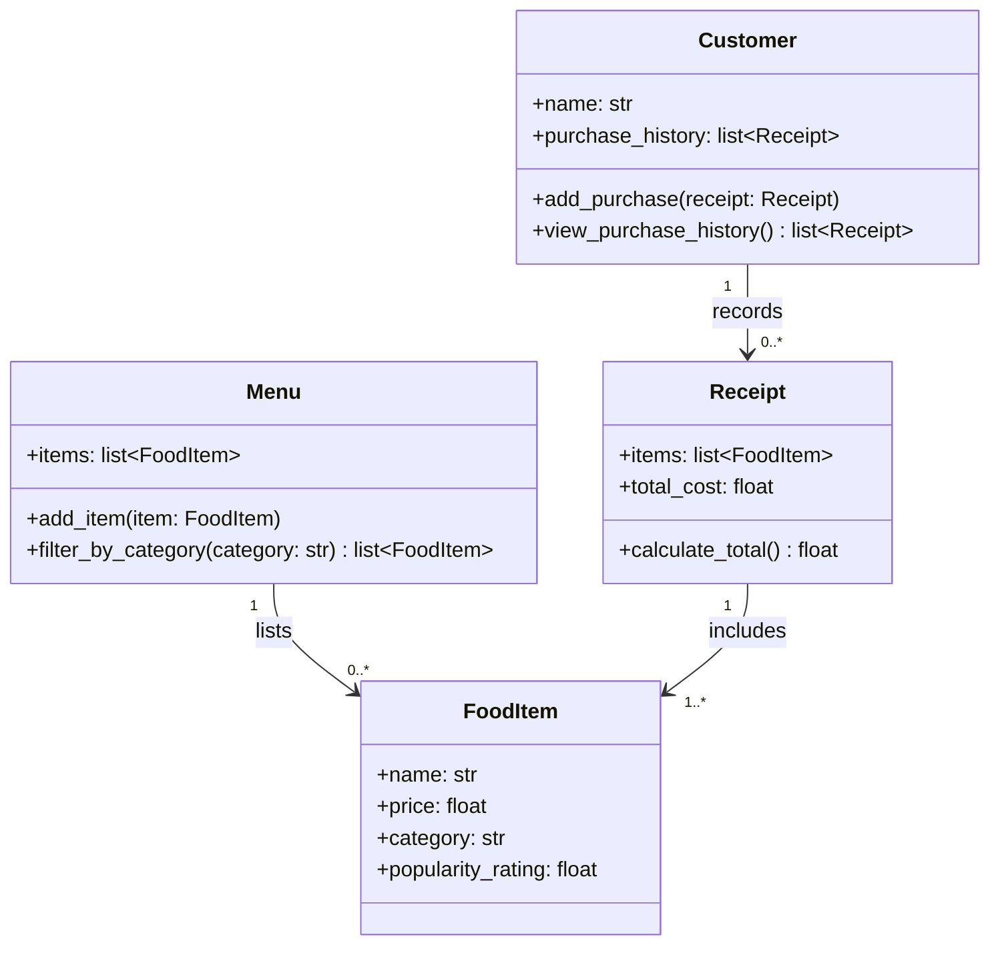

# Final ByteBites UML Class Diagram

## Relationship Summary

- A **Menu** lists zero or more **FoodItem** objects and can filter them by category.
- A **Customer** is managed by their `name` and keeps a `purchase_history` containing their past **Receipt** objects.
- A **Customer** can add a completed receipt to their purchase history and view that history.
- Each **Receipt** represents one single transaction and includes one or more selected **FoodItem** objects.
- A **Receipt** calculates the total cost from its selected items and stores the result in `total_cost`.
- The relationships to **FoodItem** are associations rather than compositions because menu items can be listed by the menu and included in receipts without either object owning the item's lifecycle.

## Why Mermaid?

Mermaid was used because it supports UML-style class-diagram notation and can render directly in Markdown previews, including VS Code. The diagram still uses standard class-diagram concepts such as classes, attributes, methods, associations, and multiplicities. It is not intended to represent a programming-language implementation.
